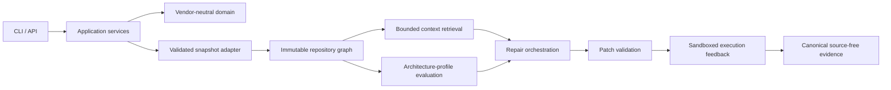
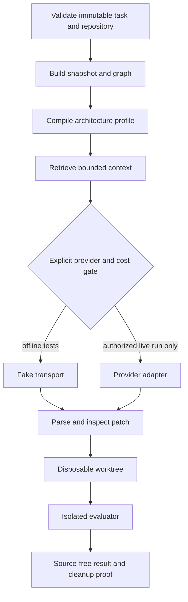

# ArchGuard-APR

ArchGuard-APR is a research prototype for architecture-constraint-aware automated program repair. It combines deterministic repository graphs, explicit architecture profiles, graph-guided context retrieval, isolated execution feedback, and reproducible experiment artifacts.

[](https://github.com/majidfeiz/archguard-apr/actions/workflows/ci.yml)
[](pyproject.toml)
[](LICENSE)
[](https://doi.org/10.5281/zenodo.23377964)
[](https://doi.org/10.5281/zenodo.23377882)

> **Research status:** this is research software, not a production repair service. Implementation verification is extensive; current effectiveness evidence is exploratory, underpowered, and negative/inconclusive. The English manuscript is a published preprint and has not been peer reviewed; the Persian manuscript remains an unpublished author manuscript.

## Overview

The system treats architecture conformance, repository provenance, context selection, patch policy, execution isolation, cost accounting, and source-free evidence as explicit boundaries. Its core is a ports-and-adapters modular monolith: entrypoints call application services, application depends only on domain contracts, and infrastructure implements external adapters.

## Motivation

A locally plausible patch can violate module boundaries, depend on incomplete context, or pass an insufficient test. ArchGuard-APR studies whether explicit architecture information can be integrated into a safe, auditable repository-level repair pipeline. Engineering maturity and repair effectiveness are reported separately.

## Key capabilities

- Source-safe Python AST snapshots without importing or executing target code.
- Immutable repository graphs and deterministic structural queries.
- Explicit, versioned architecture profiles and conformance reports.
- Bounded graph-guided context retrieval with provenance.
- Provider-neutral typed orchestration and offline fake transports.
- Strict patch parsing, path policy, detached worktrees, and architecture deltas.
- Docker-only sandbox execution feedback with resource and network controls.
- Reproducible experiments, resumable accounting, and canonical source-free artifacts.

## Architecture diagram



## Repair workflow



## Current scientific evidence

Phase 13 was an exploratory feasibility evaluation: six executions were planned, four completed, and two black-4 slots had pre-provider infrastructure attrition. Two valid paired tasks remained. Baseline success was 0/2; ArchGuard success was 0/2; all four completed outputs were invalid patches. No effectiveness advantage was observed. The study is underpowered and supports no generalization, equivalence, superiority, or state-of-the-art claim. See the [final verification](docs/phase-13-final-verification.md) and [paper-ready results](research/results/phase-13/paper-ready-results.json).

## Installation

Requirements: Python 3.12 or 3.13, [uv](https://docs.astral.sh/uv/), and Git. Docker is optional for ordinary development and required only for sandbox execution checks.

```bash
git clone https://github.com/majidfeiz/archguard-apr.git
cd archguard-apr
uv sync --frozen
```

## Quick start

These commands are offline and do not execute a scientific experiment or contact a provider:

```bash
uv run archguard version
uv run archguard doctor
uv run archguard config show --config configs/app.example.yaml
uv run archguard experiment validate --config configs/experiments/smoke.yaml
```

## Configuration

Configuration precedence is environment, current-directory `.env`, explicit YAML/constructor values, then defaults. Use [`.env.example`](.env.example) only as a placeholder template. Provider credentials are read from the environment and must never be committed. See [provider configuration](docs/providers/configuration.md).

## CLI examples

```bash
uv run archguard repository analyze examples/python/simple-layered-app \
  --source-root src --output /tmp/archguard-snapshot.json
uv run archguard graph build /tmp/archguard-snapshot.json \
  --output /tmp/archguard-graph.json
uv run archguard graph inspect /tmp/archguard-graph.json
```

## Architecture-profile example

```bash
uv run archguard architecture profile validate examples/architecture/simple-layered.yaml
uv run archguard architecture profile compile examples/architecture/simple-layered.yaml \
  --output /tmp/archguard-profile.json
uv run archguard architecture evaluate /tmp/archguard-graph.json \
  --profile examples/architecture/simple-layered.yaml \
  --output /tmp/archguard-report.json
```

## Context-retrieval example

```bash
uv run archguard context query compile \
  --problem examples/context/problem.txt --traceback examples/context/traceback.txt \
  --module demo.service --symbol item_names --output /tmp/archguard-context-query.json
```

See [context retrieval](docs/architecture/context-retrieval.md) for the snapshot-bound query and bundle workflow. Source-bearing bundles must stay outside tracked repositories.

## Patch-validation example

```bash
uv run archguard patch inspect examples/patches/preserves-architecture.diff
```

Patch inputs are untrusted data. Inspection does not execute them. See [patch validation](docs/architecture/patch-validation.md).

## Sandboxed execution example

Validate a trusted plan without running candidate code:

```bash
uv run archguard execution plan validate --plan examples/execution/archguard-self.yaml
```

Actual candidate evaluation is Docker-only and never falls back to a host subprocess. See [execution feedback](docs/architecture/execution-feedback.md).

## Reproducibility

```bash
uv run python paper/scripts/build_paper_artifacts.py
uv run python paper/scripts/check_bilingual_equivalence.py --check
uv run python paper/scripts/build_publication_documents.py --format validate
uv run pytest
```

Phase 13 source-free data are under [`research/results/phase-13`](research/results/phase-13), and publication transformation is documented in [`paper/README.md`](paper/README.md). Do not rerun the scientific experiment to reproduce the reported tables.

## Experimental results

The canonical result set contains four provider outcomes (`invalid_patch`) and two pre-provider infrastructure attritions. Combined observed usage was 35,431 input and 2,737 output tokens, costing USD 0.1296325 under the frozen configuration. These descriptive values are not effectiveness or cost forecasts. See the [result tables](paper/tables/) and [attrition report](paper/data/phase-13-attrition.csv).

## Limitations

- Only two valid paired tasks and one represented project.
- Zero successful repairs and no discordant successful pair.
- 33.3% infrastructure attrition.
- Patch-format/policy rejection dominated completed outcomes.
- Static analysis does not model every dynamic or reflective relation.
- Architecture profiles encode human judgment.
- Sandboxing reduces risk but does not eliminate it.

## Repository structure

| Path | Purpose |
|---|---|
| `src/archguard/` | Domain, application, infrastructure, schemas, and entrypoints |
| `configs/` | Example and frozen configuration metadata |
| `examples/` | Synthetic, non-secret examples |
| `tests/` | Unit, integration, architecture, and safety tests |
| `research/` | Canonical source-free research records |
| `paper/` | Bilingual manuscripts, tables, figures, and publication files |
| `docs/` | Architecture, research, schema, provider, and release documentation |

## Documentation

Start with the [architecture overview](docs/architecture/overview.md), [development guide](docs/development.md), [research protocol](docs/research/research-protocol.md), and [public artifact policy](docs/release/public-artifact-policy.md).

## Citation

Choose the citation that matches the reused artifact:

- **Preprint:** Majid Feiz Deilami (2026). *ArchGuard-APR: Architecture-Constraint-Aware Multi-Agent Program Repair Using Repository Graphs and Execution Feedback* (Version 1.0.0) [Preprint]. Zenodo. https://doi.org/10.5281/zenodo.23377965
- **Software:** Majid Feiz Deilami (2026). *ArchGuard-APR: Architecture-Constraint-Aware Multi-Agent Program Repair with Repository Graphs and Execution Feedback* (Version v0.12.8) [Software]. Zenodo. https://doi.org/10.5281/zenodo.23377882

The repository remains software in [`CITATION.cff`](CITATION.cff), with the version-specific preprint DOI as its preferred citation. Copyable BibTeX and role guidance are in [`paper/citation/`](paper/citation/README.md).

## Published manuscripts

The English author manuscript was published as an open-access Zenodo preprint on 14 October 2026 (Version 1.0.0; [concept DOI](https://doi.org/10.5281/zenodo.23377964); [version record](https://zenodo.org/records/23377965)). It has **not been peer reviewed** and is not an accepted journal or conference article. The Persian manuscript remains an unpublished, not-peer-reviewed author manuscript.

- English preprint source files: [PDF](paper/dist/ArchGuard-APR-English.pdf) · [Word](paper/dist/ArchGuard-APR-English.docx)
- Persian author manuscript: [PDF](paper/dist/ArchGuard-APR-Persian.pdf) · [Word](paper/dist/ArchGuard-APR-Persian.docx)

## Security

Read [`SECURITY.md`](SECURITY.md) before reporting a vulnerability. Never include credentials, raw provider output, benchmark source, gold patches, or personal data in a public issue.

## Contributing

See [`CONTRIBUTING.md`](CONTRIBUTING.md), [`AGENTS.md`](AGENTS.md), and [`CODE_OF_CONDUCT.md`](CODE_OF_CONDUCT.md). Research integrity and provenance requirements apply.

## License

Source code is Apache-2.0 under [`LICENSE`](LICENSE). Original documentation is CC BY 4.0 under [`docs/LICENSE.md`](docs/LICENSE.md); author-owned manuscript material is scoped in [`paper/LICENSE.md`](paper/LICENSE.md). Third-party material retains its original terms; see [`THIRD_PARTY_NOTICES.md`](THIRD_PARTY_NOTICES.md).

## Author/contact

**Majid Feiz Deilami** (مجید فیض دیلمی), M.Sc. Student in Software Engineering<br>
Department of Computer Engineering, Lahijan Branch, Islamic Azad University, Lahijan, Iran<br>
[ORCID 0009-0006-8439-1839](https://orcid.org/0009-0006-8439-1839) · `majid.feiz@iau.ir`
