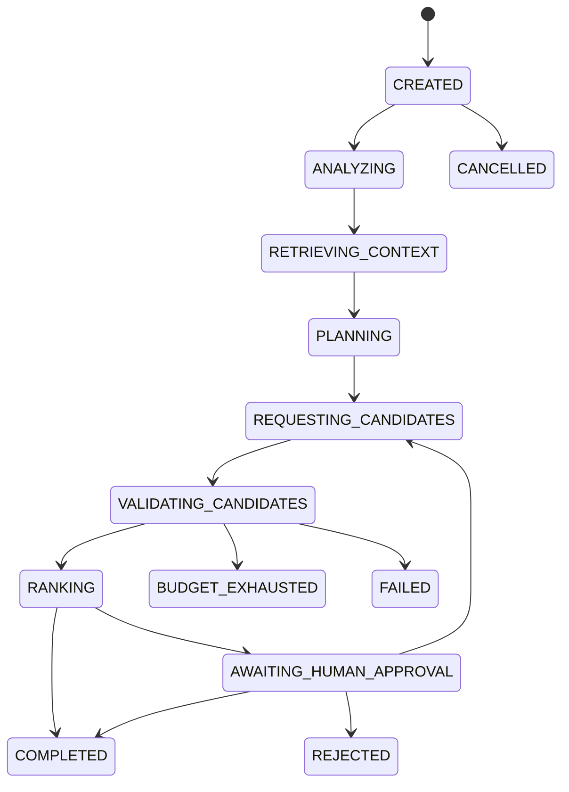

# Provider-neutral repair orchestration

Phase 8 coordinates typed, untrusted decision sources through a single deterministic coordinator.
Agents return data; they cannot set state, access Git/Docker, run commands, apply patches, or replace
Phase 4–7 evidence. The core imports only domain and standard-library modules.

## Roles and capabilities

| Role | Sole capability |
| --- | --- |
| Coordinator | applies legal transitions and budgets; no source modification |
| Context analyst | request graph-derived context references |
| Repair planner | propose structured plans |
| Patch proposer | submit immutable patch references |
| Architecture reviewer | review recorded architecture evidence |
| Execution reviewer | review recorded execution evidence |
| Candidate ranker | rank verified candidate summaries |
| Human gate | record an explicit decision |

Sensitive artifacts require both a dedicated capability and explicit acknowledgement. None of the
reference roles receives that capability. Confidence is informational and never overrides evidence.

## State machine

Cancellation and budget exhaustion are legal from every nonterminal state. Terminal states cannot
transition. Every coordinator transition is evented; agents cannot assign state.

## Events, checkpoints, replay, and resume

Events use monotonic sequence numbers, deterministic payload order, SHA-256 identities, and a
previous-event fingerprint. The chain detects alteration, removal, duplication, reordering, and
cross-run substitution. It proves consistency, not authorship.

A checkpoint binds the run specification, semantic state, last sequence, event-chain identity,
remaining budgets, candidate evidence, selection, and pending human decision. Resume verifies the
full chain and checkpoint before continuing. Replay rebuilds state from events and performs no agent
invocation, patch application, source read, or execution. Rerun is a new run and may repeat effects.

## Candidate ranking, budgets, retries, and human decisions

Ranking considers only verified evidence in this order: all mandatory gates; regressions; target
fixes (descending); introduced architecture violations; persistent failures; patch bytes; changed
files; patch fingerprint tie-breaker. Confidence is excluded. Rejected candidates retain reasons;
duplicate patch fingerprints are idempotent and do not consume another validation budget.

Budgets separately bound steps, invocations, candidates, validations, retries, input units, output
units, and total provider-neutral units. Rejected agent responses are charged. Cached/idempotent
candidate registration is not. Exhaustion is terminal and distinct from failure. Only explicitly
classified transient failures may be retried, up to the configured retry budget; architecture and
functional rejection are never retryable infrastructure failures.

Human decisions bind the exact run, selected validated candidate, and checkpoint. Missing or stale
approval is never approval. Approve, reject, revise, and cancel are explicit append-only decisions.

## Threat model and CLI

Structured validation rejects role escalation, prohibited/unknown actions, validation bypass,
fabricated evidence claims, sensitive access, cross-run references, malformed/oversized responses,
and stale checkpoints. This reduces risk but does not make future model output trustworthy. Docker
remains in the Phase 7 trusted computing base; passing tests is incomplete correctness evidence.

Commands are under `archguard repair run`, `repair candidate`, and `repair decision`. Exit codes are
0 success, 1 rejection, 2 invalid input, 3 infrastructure, 4 incomplete, 5 budget exhausted,
6 human action required, and 7 integrity/replay failure. Ordinary output is source-free.
