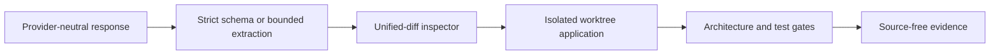

# ArchGuard-APR V2 engineering foundation

V2.1 hardens response contracts, patch extraction, diagnostics, and benchmark preflight. It is an
offline engineering phase. It did not run a repair experiment or call a model provider, and it has
not demonstrated improved repair effectiveness.



Safe offline quick start:

```bash
uv sync --frozen
uv run archguard experiment v2 preflight \
  --manifest examples/v2/preflight-ready.json \
  --output /tmp/archguard-v2-preflight.json
```

This synthetic example accesses no benchmark repository and makes no provider request. See the
[patch reliability](patch-reliability.md), [experiment design](experiment-design.md), and
[roadmap](roadmap.md).

## Reproducibility checklist

- Record commit, Python version, lock fingerprint, platform, and configuration.
- Keep outputs outside analyzed roots and compare canonical artifacts byte-for-byte.
- Verify frozen task/revision, license, evaluator/profile fingerprints, and controls.
- Disable network for candidate execution; preserve sandbox, resource, and cleanup gates.
- Scan outputs for source, secrets, paths, gold patches, and restricted evaluator material.
- Report attrition separately from repair failure and never replace tasks by outcome.

## Troubleshooting

If `uv sync --frozen` reports lock drift, do not regenerate the lock during reproduction; use the
documented Python 3.12/3.13 range and the committed `uv.lock`. If Docker is unavailable, preflight
must report a sandbox blocker; do not fall back to host candidate execution. On macOS, Docker/Linux
qualification evidence remains distinct from local engineering checks. If the output already
exists, choose a new path because artifacts are immutable. Keep `/tmp` output outside the checkout.
